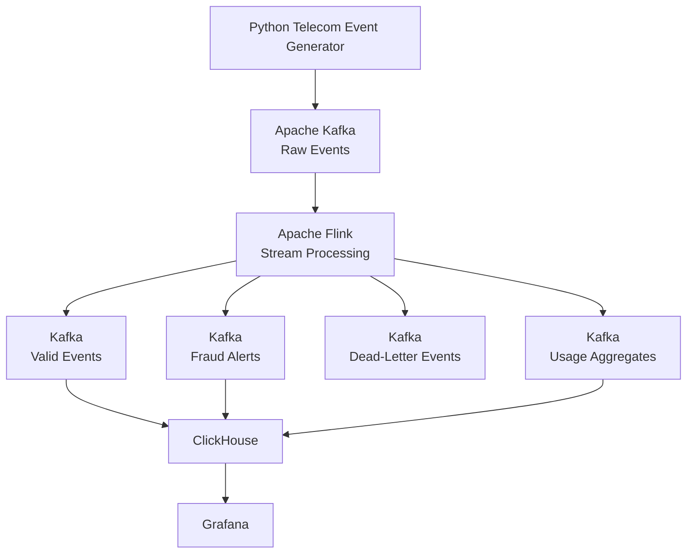

# Real-Time Telecom Fraud & Usage Intelligence Pipeline

A locally deployed, end-to-end streaming data pipeline that ingests synthetic telecom events, processes them with Apache Flink, detects suspicious activity, aggregates usage data, and makes the results available through ClickHouse and Grafana.

**Python · Apache Kafka · Apache Flink · ClickHouse · Grafana · Docker Compose**

---

## Project overview

Telecom platforms continuously generate events such as mobile data usage, calls, SMS, logins, top-ups, SIM swaps, and device changes.

This project explores how those events can be processed as continuous streams to identify suspicious behavior and produce useful operational analytics.

What started as an empty project became a connected pipeline covering:

- Synthetic telecom event generation.
- Kafka-based event ingestion and partitioning.
- Stateful stream processing with Apache Flink.
- Event validation and fraud/risk detection.
- Usage aggregation by country and time window.
- Analytical storage in ClickHouse.
- Dashboard visualisation through Grafana.

The project uses synthetic data and runs locally through Docker Compose. It is a practical data engineering implementation, not a production telecom deployment.

## Project results

The following figures were observed during the current development run. They are not benchmark claims.

| Metric | Observed result |
|---|---:|
| Fraud alerts stored in ClickHouse | **13,479** |
| Underlying usage events represented in aggregates | **166,724** |
| Usage aggregation records | **396** |
| Reported data volume | **Approximately 83.36 million MB** |
| Raw Kafka topic partitions | **3** |
| Flink source records received in captured UI | **308,503** |

The figures come from different components and measurements. They should not be interpreted as a single end-to-end event count.

---

## Dashboard

The Grafana dashboard brings the processed data into a visual interface, making fraud alerts and telecom usage patterns easier to inspect.


### Additional dashboard views


---

## Architecture



### Data flow

1. A Python generator creates synthetic telecom events.
2. Kafka receives and distributes the raw events across partitions.
3. Flink consumes the stream and applies validation, processing, and detection logic.
4. Processed events are routed to dedicated Kafka topics.
5. ClickHouse consumes the analytical outputs and stores them for querying.
6. Grafana visualises fraud alerts and usage aggregates.

---

## Technical evidence

### Kafka: topics and partitions

Kafka separates the incoming events and processed outputs into dedicated topics.

The raw event topic, `telecom.raw.events.v1`, is configured with three partitions and replication factor one.


The project topics include:

| Topic | Purpose |
|---|---|
| `telecom.raw.events.v1` | Incoming source events |
| `telecom.valid.events.v1` | Validated events |
| `telecom.dlq.events.v1` | Invalid events |
| `telecom.fraud.alerts.v1` | Fraud and risk alerts |
| `telecom.usage.country.minute.v1` | Country-level usage aggregates |
| `telecom.usage.late-events.v1` | Late-arriving events |

### Apache Flink: running stream processing

The Flink job connects to the Kafka source and processes the incoming event stream.


The captured Flink UI showed:

- The stream-processing job in `RUNNING` state.
- 308,503 records received by the source operator at the time of capture.
- Multiple downstream operators handling the processing branches.

### Processing activity


These screenshots document the running system and its processing activity at the time they were captured.

---

## Fraud detection

The pipeline implements four rule-based fraud and risk scenarios:

| Detection rule | Description |
|---|---|
| `TOP_UP_VELOCITY` | Identifies unusually frequent top-up attempts |
| `SIM_SWAP_RISK` | Detects risky activity following a SIM swap |
| `IMPOSSIBLE_TRAVEL` | Flags logins from distant countries within an implausible interval |
| `USAGE_SPIKE` | Identifies unusually high data usage |

Each stored alert includes information such as the rule, severity, customer, detection time, contributing event IDs, and evidence.

The current stored alert breakdown is:

| Rule | Alerts |
|---|---:|
| Impossible travel | 11,441 |
| Usage spike | 2,015 |
| Top-up velocity | 19 |
| SIM-swap risk | 4 |
| **Total** | **13,479** |

These are alerts generated from synthetic scenarios and configured rules. They are not confirmed real-world fraud cases.

---

## Telecom usage analytics

The pipeline also produces country-level usage aggregates.

Current observed data:

| Country | Aggregation records | Underlying events |
|---|---:|---:|
| Netherlands | 96 | 41,969 |
| Germany | 96 | 41,848 |
| Belgium | 108 | 41,507 |
| France | 96 | 41,400 |
| **Total** | **396** | **166,724** |

The aggregate records contain total data volume and event counts for their respective country and time windows.

---

## Technology stack

| Technology | Role |
|---|---|
| Python | Synthetic event generation and application logic |
| Apache Kafka | Event ingestion, topics, and partitioning |
| Apache Flink | Stateful stream processing |
| ClickHouse | Analytical storage and querying |
| Grafana | Dashboard visualisation |
| Docker Compose | Local service orchestration |

---

## Repository structure

```text
telecom-streaming-pipeline/
├── docker-compose.yml
├── README.md
├── configs/
├── generator/
│   └── src/
├── flink_job/
│   └── src/
├── clickhouse/
│   └── init/
├── grafana/
│   ├── dashboards/
│   │   ├── telecom-fraud-detection.json
│   │   └── v1/
│   └── provisioning/
├── docs/
│   ├── Flink streams Running.png
│   ├── Kafka topics and partitions.png
│   ├── Processing in action.png
│   └── v1/
└── scripts/
```

---

## Running the project

The project uses Docker Compose to run its local services.

Start the relevant infrastructure:

```bash
docker compose up -d
```

Build the Flink containers when the job image or dependencies change:

```bash
docker compose build jobmanager taskmanager
```

Submit the Flink job:

```bash
docker exec telecom-flink-jobmanager flink run -d -py /opt/flink/usrlib/main.py
```

Check the running job:

```bash
docker exec telecom-flink-jobmanager flink list
```

The Flink dashboard is available at:

`http://localhost:8081`

The exact producer and service startup commands may depend on the local environment and project configuration.

---

## Current scope and limitations

- The pipeline runs locally using Docker Compose.
- Events are synthetic, not sourced from a telecom operator.
- Fraud detection is rule-based; a trained ML fraud model is not part of the current implementation.
- Kafka's raw topic currently uses replication factor one, so it does not provide broker-level replica redundancy.
- Observed record counts describe specific component outputs and capture times, not a controlled throughput benchmark.
- Production deployment, high availability, and production-scale performance have not been claimed.

---

## Future improvements

Potential next steps include:

- Benchmarking sustained throughput and end-to-end latency.
- Expanding automated integration and recovery tests.
- Improving pipeline health and consumer-lag observability.
- Building additional customer-level analytical features.
- Exploring machine-learning-based anomaly detection.

---

## Project links

**Source code:** [GitHub repository](https://github.com/salehsami/Telecom-Streamin-Pipeline)

